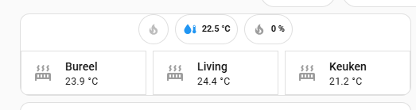

# Automatiseringen en bediening

## Normale bediening

Gebruik de drie zonehelpers om te kiezen waar dagcomfort gewenst is:

- `input_boolean.cv_bureel`;
- `input_boolean.cv_living_aan`;
- `input_boolean.cv_keuken_en_tussen_aan`.

De templateschakelaar `switch.verwarming_dummy` zet deze drie tegelijk aan of uit. De gewenste dag- en nachttemperatuur worden ingesteld met `input_number.temp_wens_dag` en `input_number.temp_wens_nacht`.

Een zone uitzetten schakelt haar boosthelper onmiddellijk uit via een afzonderlijke automatisering.

## Zoneknoppen op het dashboard

Het dashboard bevat drie grote verwarmingsknoppen voor **Bureel**, **Living** en **Keuken**:

Elke knop toont de naam van de zone en de actuele temperatuur van haar losse kamersensor.

### Gewone tik: zone aan of uit

Een enkele tik wisselt de zone tussen dag- en nachtregeling:

| Dashboardknop | Geschakelde helper | Bereik |
|---|---|---|
| Bureel | `input_boolean.cv_bureel` | Bureel |
| Living | `input_boolean.cv_living_aan` | Living |
| Keuken | `input_boolean.cv_keuken_en_tussen_aan` | Keuken én Tussen |

Een ingeschakelde zone gebruikt de dagtemperatuur. Een uitgeschakelde zone gebruikt de toepasselijke nachtregeling.

De kleur van het pictogram geeft de toestand aan:

- **grijs**: de zone staat uit;
- **groen**: de zone staat aan en zit op maximaal 0,3 °C van de dagtemperatuur;
- **oranje**: de zone staat aan en heeft meer dan 0,3 °C warmtevraag;
- **rood**: de zone staat aan en heeft meer dan 1,5 °C warmtevraag, of boost is actief.

### Dubbele tik: boost starten

Een dubbele tik op een zoneknop start `script.cv_boost_zone_slim` voor die zone. Het script:

1. schakelt de zone in;
2. activeert de bijbehorende boosthelper;
3. legt een eindtijd vast op 60 minuten na de start;
4. controleert iedere minuut of de gewenste dagtemperatuur is bereikt;
5. stopt bij bereiken van het doel, bij uitschakelen van de zone of uiterlijk na 60 minuten.

Tijdens boost verandert het radiatorpictogram in een rood vlampictogram. Onder de zonenaam verschijnen de actuele temperatuur, een pijl en het geschatte aantal resterende minuten. Bij **Keuken** geldt de zone-inschakeling ook voor Tussen, terwijl de boostcontrole de keukensensor gebruikt.

> Een enkele tik en een dubbele tik hebben dus verschillende acties. Voor boost moet werkelijk dubbel worden getikt; een enkele tik zet alleen de zone aan of uit.

## Automatisch uitschakelen tijdelijk blokkeren

In het instellingenscherm staat de schakelaar **Automatisch Uit** (`input_boolean.automatisch_uit`). Normaal mag de verwarming door de automatische dag-/nachtroutines worden uitgeschakeld. Zet deze schakelaar uit wanneer die automatische uitschakeling die dag niet gewenst is.

De afwijkende keuze is tijdelijk: de schakelaar wordt iedere dag gereset, zodat de normale automatische werking de volgende dag opnieuw geldt. Zie dit als een dagschakelaar en niet als een permanente configuratiewijziging.

## Dag/nacht

Op `input_datetime.begin_nacht` — bij de opname 22:00 — voert `CV Uit op tijdstip` het volgende uit:

1. `counter.cv_counter` resetten;
2. Bureel, Living, Keuken + Tussen en de gastenkamer uitzetten;
3. `input_boolean.cv_nacht_bezig` aanzetten.

Omdat uitgeschakelde hoofd-zones de nachttemperatuur als doel krijgen, blijft de installatie zo nodig nachtverwarming leveren.

Om 07:00 gaat `cv_nacht_bezig` weer uit. De automatisering `CV sNachts uit na 1H` bevat aanvullende oude counterlogica, maar de counter wordt in de onderzochte actieve cv-regeling niet verhoogd. Daardoor is niet zichtbaar dat deze een-uursactie in de huidige opzet werkelijk wordt geactiveerd.

### Eenmalige ochtendstart

De schakelaar **CV: eenmalige ochtendstart** is bedoeld voor een dag waarop je de comfortverwarming tijdelijk eerder wilt starten. Wanneer deze automatisering vooraf wordt aangezet, doet ze om 06:00 het volgende:

1. de nachtmarkering uitzetten;
2. Living inschakelen;
3. Keuken + Tussen inschakelen;
4. zichzelf weer uitschakelen.

Het is dus een eenmalige startkeuze: zet de schakelaar opnieuw aan vóór iedere dag waarop om 06:00 moet worden verwarmd. Bureel en de gastenkamer worden door deze 6u-actie niet ingeschakeld.

## Afwezigheid

Wanneer `binary_sensor.iedereen_afwezig` vijf minuten aan blijft, zet `CV: zones uitschakelen bij afwezigheid` de volgende zones uit:

- Bureel;
- Living;
- Keuken + Tussen.

Daarna volgen deze zones de nachttemperatuur. Er is in deze automatisering geen automatische herstelactie bij thuiskomst gevonden.

## Boost

Er zijn boosts voor Bureel, Living en Keuken. Het script `script.cv_boost_zone_slim` is bedoeld om een zone maximaal 60 minuten te boosten:

1. eindtijd op nu + 60 minuten zetten;
2. zone aanzetten;
3. boosthelper aanzetten;
4. iedere minuut controleren of de dagtemperatuur tot op 0,2 °C bereikt is;
5. boost uitschakelen bij bereiken van het doel, uitschakelen van de zone of na 60 minuten.

Daarnaast schakelt `CV Boost Auto Stop` **alle drie** boosthelpers uit zodra de grootste zone-delta kleiner dan 0,5 °C is. Daardoor kan een boost in één ruimte eindigen doordat een andere berekende toestand de gezamenlijke maximumdrempel beïnvloedt.

Tijdens boost openen de kranen van de gebooste zone volledig en gebruikt de actieve ketelregelaar `input_number.cv_boost_aanvoer_temp` als OpenTherm-setpoint. Dit gebeurt alleen wanneer `input_boolean.cv_ketelsturing_ha_actief` aan staat.

## Onderhoudsstand: alle kranen open

`input_boolean.alle_cv_kranen_open_test` bedient `(TEST) Alle CV kranen open`:

- bij **aan** wordt `automation.status_cv` uitgezet en krijgen alle gevonden RT-kranen een setpoint van 30 °C;
- bij **uit** wordt `automation.status_cv` weer aangezet en krijgen alle RT-kranen eerst de nachttemperatuur.

Deze stand opent alleen de radiatorkranen. De actieve ketelregeling blijft apart werken op basis van de zonehelpers en kamersensoren. Dit is dus geen garantie dat de ketel ook vuur maakt.

Deze stand is nodig tijdens de 2 jaarlijkse onderhoudsbeurt.

## Automatiseringsstatus bij de opname

| Automatisering | Status |
|---|---|
| Status CV - Alle ruimtes (script) | aan |
| CV Control Setpoint Dynamisch | aan |
| Buiten Temp -> CV | aan |
| Herstart OTGW (losse HA-automatisering; buiten het package) | aan |
| CV Uit op tijdstip | aan |
| Afwezigheid: zones uit | aan |
| CV Boost Auto Stop | aan |
| Stop boost bij zone uit (3 stuks) | aan |
| CV: eenmalige ochtendstart | dagschakelaar; bij de opname uit |
| Oude MQTT dag-/nachttemperatuurpublicaties | uit |
| Onderhoudsautomatisering alle kranen open | aan; testhelper zelf uit |

Een automatisering die “aan” staat, voert alleen acties uit wanneer haar trigger optreedt. Voor de onderhoudsautomatisering betekent dat niet dat de onderhoudsstand actief is.
